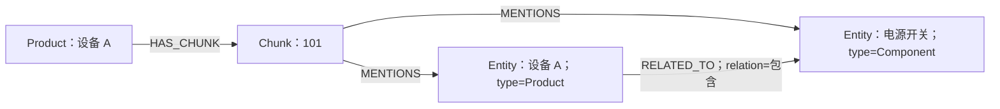

# Neo4j 知识图谱接入说明

本文根据项目当前代码整理，说明图谱数据如何产生、如何入库、如何参与多路召回，以及测试覆盖了哪些行为。示例中的商品名和切片 ID 均为演示数据。

Neo4j 为现有 RAG 增加了一条基于实体关系的召回通道。Milvus 继续保存切片原文和向量，Neo4j 保存实体、关系和切片出处，两边通过同一个 `chunk_id` 关联。

```text
导入：文档 → 切片 → 商品识别 → 向量化 → Milvus 入库并回填 ID → Neo4j 入库
查询：问题 → 确认商品 → 图谱匹配实体与关系 → 切片 ID → Milvus 原文 → RRF → 重排 → 回答
```

例如，问题包含“无法启动”，图谱中记录“无法启动”与“电源开关”有关，就可以进一步找到介绍电源开关检查方法的切片。这些原文随后与向量召回结果一起参与排序。

## 1. 相关代码在哪里

路径相对于项目根目录；以下既包含新增文件，也包含接入时使用或调整的现有文件。

| 文件 | 职责 |
|---|---|
| [app/clients/neo4j_utils.py](../app/clients/neo4j_utils.py) | 创建、复用 Neo4j Driver |
| [app/import_process/agent/nodes/node_import_kg.py](../app/import_process/agent/nodes/node_import_kg.py) | 校验切片、抽取实体关系、整理数据、事务写入 |
| [app/import_process/agent/nodes/kg_evidence_sources.py](../app/import_process/agent/nodes/kg_evidence_sources.py) | 给原文分段编号，根据模型引用的起止编号还原连续证据 |
| [prompts/kg_extraction.prompt](../prompts/kg_extraction.prompt) | 规定模型输出结构、实体分类和原文证据要求 |
| [app/lm/lm_utils.py](../app/lm/lm_utils.py) | 提供 `get_llm_client(json_mode=True)`，图谱抽取复用此客户端 |
| [app/import_process/agent/main_graph.py](../app/import_process/agent/main_graph.py) | 将图谱节点接在 Milvus 入库之后 |
| [app/import_process/agent/state.py](../app/import_process/agent/state.py) | 声明抽取结果与入库统计字段 |
| [app/query_process/agent/nodes/node_query_kg.py](../app/query_process/agent/nodes/node_query_kg.py) | 查询图谱、回查原文、返回 `kg_chunks` |
| [app/clients/milvus_utils.py](../app/clients/milvus_utils.py) | 按切片 ID 批量取回原文，并恢复输入排名 |
| [app/query_process/agent/nodes/node_rrf.py](../app/query_process/agent/nodes/node_rrf.py) | 将图谱结果加入 RRF 去重融合 |
| [app/query_process/agent/main_graph.py](../app/query_process/agent/main_graph.py) | 注册图谱召回分支，并接入现有汇合流程 |
| [app/query_process/agent/state.py](../app/query_process/agent/state.py) | 声明查询状态中的 `kg_chunks` |
| [app/utils/task_utils.py](../app/utils/task_utils.py) | 管理“导入知识图谱”“查询知识图谱”等进度名称 |
| [app/test/test_import_kg_write.py](../app/test/test_import_kg_write.py) | 验证数据整理、重复导入、替换、回滚、ID 冲突与并发写入 |

节点逻辑仍由各自的 `agent/nodes/` 文件夹管理，`main_graph.py` 负责注册和连线。`step_1`、`step_2` 等是节点内部函数，无需单独注册到 LangGraph。

## 2. 数据模型与编号

### 2.1 商品、切片、实体和关系

假设切片原文是“设备 A 配有电源开关。”，保存后的结构如下：



| 节点或关系 | 保存的信息 | 用途 |
|---|---|---|
| `Product` 节点 | `name` | 表示文档所属商品，限定导入和查询范围 |
| `Chunk` 节点 | `chunk_id`、`item_name`、`title`、`file_title` | 表示原文切片，连接 Milvus 中的文本 |
| `Entity` 节点 | `entity_key`、`name`、`type`、`item_name` | 表示原文中的商品、部件、故障、操作等对象 |
| `HAS_CHUNK` 关系 | 无额外业务属性 | 商品包含哪个切片 |
| `MENTIONS` 关系 | `evidence` | 哪个切片提到了哪个实体，以及原文依据 |
| `RELATED_TO` 关系 | `relation`、`chunk_id`、`evidence`、`item_name` | 实体间的事实及其来源 |

`Product` 节点和 `Entity(type="Product")` 职责不同：前者用于组织文档，后者表示原文实际提到的商品实体。原文没有提到商品名称时，也可以只有所属商品节点而没有相应的商品实体。

实体分类统一放在 `Entity.type` 属性中，允许的值是 `Product`、`Component`、`Fault`、`Operation`、`Parameter`、`Material`、`Function`、`Condition`、`Other`。

Neo4j 的 `Chunk` 不保存原文全文，全文留在 Milvus。图谱中的 `evidence` 保存的是支持实体或关系的一段原文，用于追溯事实。

### 2.2 为什么不能直接把 e1 当作数据库主键

| 编号 | 谁生成 | 作用范围 | 示例 |
|---|---|---|---|
| `chunk_id` | Milvus 插入切片时生成，Python 回填 | 当前切片集合与关联图谱 | `101` |
| 实体局部 `id` | 抽取模型生成 | 单个切片内部 | `e1`、`e2` |
| `entity_key` | Python 的 `_make_entity_key` 生成 | 当前应用的图谱实体 | SHA-256 的 64 个十六进制字符 |
| 证据来源 `id` | Python 的 `build_evidence_sources` 生成 | 单个切片内部，定位原文范围 | `s1`、`s2` |

切片 101 中的 `e1` 可能是“电源开关”，切片 102 中的 `e1` 可能是“无法启动”。因此临时编号只用于解析本切片的 `source` 和 `target`。

反过来，同一个实体在两个切片中可能分别叫 `e1` 和 `e3`，写入时应复用同一个图谱节点。

```python
def _make_entity_key(item_name: str, entity_type: str, name: str) -> str:
    identity = json.dumps([item_name, entity_type, name], ensure_ascii=False)
    return hashlib.sha256(identity.encode("utf-8")).hexdigest()
```

当前代码将“所属商品 + 实体类型 + 实体名称”相同的记录视为同一实体。相同输入总能计算出相同编号，便于跨切片复用和重复导入。JSON 列表避免了直接用分隔符拼接字符串可能产生的歧义。

调用前会统一实体名称中的多余空白，但不统一大小写、不合并同义词。例如，“电源开关”和“总电源开关”仍会得到不同编号。这个函数也不会识别同名的两个物理部件是否实际上不同。

### 2.3 state 中新增的字段

| 状态 | 字段 | 内容 |
|---|---|---|
| `ImportGraphState` | `kg_extractions` | 每个切片的来源信息、实体列表和关系列表 |
| `ImportGraphState` | `kg_import_stats` | 成功提交后记录本批商品、切片、实体、提及和事实关系数量 |
| `QueryGraphState` | `kg_chunks` | 已从 Milvus 补全原文的图谱召回结果 |

这些字段的默认值分别为 `[]`、`{}`、`[]`。状态工厂使用深拷贝，避免不同请求共用同一个列表。

导入函数中局部变量 `kg_chunks` 只是临时保存整理后的输入切片，与查询状态里的 `kg_chunks` 没有自动关联。当前功能也不生成一个统一的 `kg_id`；判断入库结果应查看 `kg_import_stats` 和数据库记录。

## 3. 导入流程：从原文生成图谱

### 3.1 上游提供什么数据

商品识别节点给 `state` 和每个切片补充 `item_name`。Milvus 入库节点取得 `insert()` 返回的 `ids` 后，将它们回填到对应切片的 `chunk_id`。

所以导入图中必须先执行 Milvus，再执行图谱节点：

```python
workflow.add_node("node_import_kg", node_import_kg)
workflow.add_edge("node_import_milvus", "node_import_kg")
workflow.add_edge("node_import_kg", END)
```

### 3.2 step_1_get_chunks：整理并校验输入

读取 `state["chunks"]`，逐条检查切片为字典、`chunk_id` 为非布尔整数、商品名称和原文为非空字符串。第一步只检查 ID 类型；有符号 INT64 范围在写入准备阶段检查。

该函数创建一个新列表，保留 `chunk_id`、`item_name`、`content`、`title`、`file_title`。原切片中的稠密和稀疏向量不会被删除，也不会传给抽取模型。

`chunk_id` 在这里不能重新生成，否则无法与 Milvus 原文对应。这里也不会实际连接 Milvus 验证 ID 是否存在。

### 3.3 step_2_extract_entities_relations：逐片抽取

对全部切片逐个调用现有模型客户端，使用 `get_llm_client(json_mode=True)`。系统消息放抽取规则，用户消息放 `item_name`、`title` 和 `evidence_sources`。程序先用 `build_evidence_sources(content)` 将完整原文按顺序编号，模型只需返回证据的起止编号，不必逐字复制图片说明、长 URL 或 HTML 标签。

例如，原文为“设备 A 配有电源开关。”时，用户消息中的来源列表为：

```json
{"evidence_sources": [{"id": "s1", "text": "设备 A 配有电源开关。"}]}
```

模型应返回类似结果：

```json
{
  "entities": [
    {"id": "e1", "name": "设备 A", "type": "Product", "evidence": {"start": "s1", "end": "s1"}},
    {"id": "e2", "name": "电源开关", "type": "Component", "evidence": {"start": "s1", "end": "s1"}}
  ],
  "relations": [
    {"source": "e1", "target": "e2", "relation": "包含", "evidence": {"start": "s1", "end": "s1"}}
  ]
}
```

模型不负责生成 `chunk_id`、文件标题或商品归属；程序使用输入切片的可信元数据绑定来源。

来源编号 `s1` 与实体编号 `e1` 不同：前者由程序生成，每个切片重新编号，只用于定位原文，不是数据库主键。分段优先在换行或 HTML 表格行结束处进行，每段最多 800 个 Python 字符。所有 `text` 按顺序拼接必须恰好等于 `content`，不删除空白、URL、标签或 OCR 乱码；内部保存的字符位置不发送给模型，也不重复发送一份全文。

`_parse_and_validate_extraction` 负责检查：

- 输出能解析为 JSON 对象，且 `entities`、`relations` 是列表。
- 实体的 `id/name/type`、关系的 `source/target/relation` 为非空字符串，实体类型属于允许列表，局部编号没有重复。
- 关系端点确实引用本切片中的实体。
- 编号证据的 `start/end` 引用当前切片存在的来源，顺序正确，范围不全为空白；来源映射由原文重新生成，不采用模型提供的文本或位置。
- 保存的 `evidence` 是当前 `content` 中能找到的连续原文，不能仅来自标题或商品元数据。
- 完全相同的关系记录去重。

例如，`{"start":"s2","end":"s5"}` 会由 `resolve_evidence_reference` 截取从 s2 开头到 s5 结尾的全部原文，保留中间图片、表格、否定条件和换行。模型应选择足以支持事实的最小连续范围。解析后的 `evidence` 仍是字符串，上例中三个证据均还原为“设备 A 配有电源开关。”，因此后续写库的数据结构不变。

旧的字符串证据仍兼容：例如 HTML 表格中的 `&lt; / +` 被模型写成显示文字 `< / +` 时，`_resolve_evidence` 先尝试逐字匹配；失败后，只允许一层 HTML 字符引用解码与连续空白折叠后的等价匹配。`_evidence_view` 保存字符到原文位置的映射，匹配成功后还原原文片段，最终入库的仍是 `&lt; / +`。这种兼容处理不删除标签、不改标点、不纠正 OCR，也不接受用 `...` 拼接首尾或改写 URL 的证据。

JSON、字段或证据校验失败时，程序将失败原因反馈给模型，要求使用 `start/end` 编号重新返回完整结果，只重新抽取当前切片一次。`KG_EXTRACTION_MAX_ATTEMPTS=2` 包含首次请求，成功的前序切片不会在这次函数调用内重复抽取。再次失败仍抛出带 `chunk_id` 的异常；旧字符串匹配失败时，错误只保留证据前 120 个字符，不能据此前缀确定长证据的具体差异。连接异常和超时不在这一层额外重试。

合法的空实体、空关系列表仍可通过；程序不会主动把校验失败的结果替换成空知识。整个抽取步骤成功后才赋值给 `state["kg_extractions"]`。本轮失败退出后没有持久化的抽取断点缓存，重新执行整轮导入仍会重新抽取。

保存的抽取结果包含来源字段及 `entities`、`relations`，不再复制全文；全文仍在原始 `state["chunks"]` 中。证据文本存在于原文，并不自动证明模型对因果、否定或条件的理解正确。

### 3.4 _prepare_neo4j_data：把临时结果整理为写库参数

写入前先对整批数据做校验，包括 INT64 范围、批内重复切片 ID、字段类型和关系端点引用。该函数不访问数据库。

每处理一个切片，都会重建 `local_entity_keys` 映射：

```text
当前切片的 e1 → 对应实体的 entity_key
当前切片的 e2 → 对应实体的 entity_key
关系 source/target → source_key/target_key
```

整理后的参数分为 `item_names`、`chunks`、`entities`、`mentions`、`relations` 五个列表。实体按 `entity_key` 去重，提及和事实还包含切片 ID、证据等信息，因此不同切片提供的证据可以分别保留。

这一层只验证证据字段非空，不重新验证证据是否属于原文。`step_3_save_to_neo4j` 的输入应当是已通过第二步的抽取结果，不能直接传入未校验的模型响应。

### 3.5 step_3_save_to_neo4j：约束与事务写入

首先确保三个唯一约束存在：`Product.name`、`Chunk.chunk_id`、`Entity.entity_key`。随后通过 `session.execute_write(_write_kg_transaction, data)` 执行数据事务。

`_write_kg_transaction` 中语句的顺序有明确依赖：

| 顺序 | 操作 | 原因 |
|---|---|---|
| 1 | 按商品名排序，`MERGE Product`，设置再移除临时锁属性 | 让同一商品的图谱替换串行执行，减少并发交错 |
| 2 | 检查已有 `chunk_id` 的商品归属 | 防止新数据占用其他商品或未归属切片的 ID |
| 3 | 删除本批商品的旧 `RELATED_TO` | 清理可能引用旧切片 ID 的事实 |
| 4 | 删除本批商品的旧 `Chunk` 及相连关系 | 清理旧切片、`HAS_CHUNK`、`MENTIONS` |
| 5 | 写入新 `Chunk`，连接 `HAS_CHUNK` | 建立商品与当前切片的关系 |
| 6 | 按 `entity_key` 写入或复用 `Entity` | 跨切片复用实体节点 |
| 7 | 写入带证据的 `MENTIONS` | 记录切片提及实体的原文依据 |
| 8 | 写入 `RELATED_TO` | 保存事实含义、来源 ID 和证据 |
| 9 | 清理本批商品中已无切片提及的实体 | 去掉替换后不再使用的旧实体 |

例如，实体写入使用：

```cypher
UNWIND $entities AS row
MERGE (e:Entity {entity_key: row.entity_key})
SET e.name = row.name, e.type = row.type, e.item_name = row.item_name
```

这里 `UNWIND` 将列表展开成多行，`MERGE` 根据业务标识查找或创建节点，`SET` 更新属性。建立关系时再用 `MATCH` 找到已经存在的端点。`DETACH DELETE` 则同时删除节点及其连接。

模型给出的“包含”“可能导致”等词放在 `RELATED_TO.relation` 属性中，数据库关系类型固定为 `RELATED_TO`。用户输入和模型内容作为 `$参数` 传入，不拼接为可执行 Cypher。

### 3.6 重复导入、冲突和失败如何处理

当前替换单位是商品名。Milvus 会删除该商品的旧切片，Neo4j 也用相同的商品范围删除旧图谱内容，再写入当前批次。提交时必须提供希望保留的该商品完整数据；分多次导入同一商品的不同文档，会使后一次替换前一次的内容。

重复提交相同数据不会不断累积实体和事实；仍被使用的实体可以复用原节点，但 `Chunk` 节点会删除后重建，不能依赖 Neo4j 内部节点 ID 永远不变。

两种 ID 校验分别解决不同问题：批内重复检查避免同一批切片相互覆盖；数据库冲突检查避免把另一商品已有的切片改成当前商品。仅有主键唯一约束不能代替商品归属检查。

空批次 `[]` 不操作数据库，返回全零统计。非空切片批次即使没有实体和关系，也会保存商品、切片，并清除该商品旧的知识。

统计示例：

```python
{"products": 1, "chunks": 1, "entities": 2, "mentions": 2, "relations": 1}
```

这些数值表示本批去重后的对象数量，不表示数据库总量或本次净新增量。只有数据事务成功提交后，节点才设置 `kg_import_stats`。

数据事务中途失败会回滚 Neo4j 的删除与写入。唯一约束在数据事务之前单独建立；Neo4j 事务也不能回滚此前已成功提交的 Milvus 数据。两个存储之间目前没有跨库事务或自动补偿。

`node_import_kg` 的异常向上传播；其 `finally` 仍会结束节点进度，因此前端“已完成节点”列表不能单独证明入库成功。

## 4. 查询流程：从图谱回到原文

### 4.1 接入现有多路召回

```text
node_item_name_confirm
    ├─ node_search_embedding       → embedding_chunks
    ├─ node_search_embedding_hyde  → hyde_embedding_chunks
    ├─ node_query_kg               → kg_chunks
    └─ node_web_search_mcp         → web_search_docs
                     ↓
                 node_rrf
                     ↓
                 node_rerank
                     ↓
               node_answer_output
```

四条分支在现有图结构中汇合。RRF 只对三路本地切片计分；联网结果通过状态继续传递，在 Reranker 阶段加入。商品确认节点已经生成提示答案时，仍走原有的提前输出路线。

### 4.2 node_query_kg 的三个步骤

| 函数 | 输入 | 处理与输出 |
|---|---|---|
| `step_1_prepare_kg_query` | 查询 `state` | 优先取改写问题，回退到原问题；统一问题大小写和空白，清理并去重商品列表 |
| `step_2_query_chunk_ids` | 问题、商品列表 | 在 Neo4j 匹配实体并扩展关系，返回有序候选 ID、商品归属和排名依据 |
| `step_3_fetch_kg_chunks` | 候选列表、商品列表 | 回查 Milvus，检查归属和原文，返回兼容现有检索格式的切片 |

没有问题或没有明确商品时不查询图谱。第二步以读模式创建 session，在 session 关闭前调用 `.data()` 消费查询结果。关闭 session 不会关闭全局复用的 Driver。

### 4.3 KG_RECALL_QUERY 的匹配与排序规则

首先在已确认商品范围内，匹配名称出现在问题中的 `Entity`。名称至少两个字符，比较时忽略大小写和普通空格。候选起点优先选择名称更长的实体，并以 `entity_key` 打破平局。

匹配到的实体称为 `seed`，随后执行：

```cypher
MATCH path = (seed)-[:RELATED_TO*0..1]-(entity:Entity)
```

`0` 步代表起点本身，`1` 步代表通过一条事实关系找到的邻居，查询允许从两个方向遍历。这里的无向遍历只用于发现候选，不代表改变事实原本的方向或因果含义。

`Product` 类型既不作为起点，也不作为邻居，避免仅因提到商品名就扩散到整份说明书。路径实体、关系属性、关系来源切片、最终切片必须属于同一商品。最终切片还必须通过 `HAS_CHUNK` 归属该商品，并通过 `MENTIONS` 提到目标实体。

同一切片的多条命中路径会聚合，返回：

```python
{
    "chunk_id": 101,
    "item_name": "设备 A",
    "hop_count": 0,
    "matched_entities": 1
}
```

`hop_count` 是该切片与命中起点之间最短的扩展步数；`matched_entities` 是能关联到该切片的不同起点数量。先按步数升序排列，再按起点数量降序排列，最后按切片 ID 升序保证顺序稳定。

例如，查询“无法启动”时，直接提到该故障的切片优先；通过“电源开关”这个邻居找到的接线说明排在后面。需要沿两条关系才能到达的实体不会继续展开。

### 4.4 Milvus 回查与结果格式

`fetch_chunks_by_chunk_ids` 对 ID 做严格 INT64 校验和去重，排除布尔值、小数和越界数。优先使用 `get`，发生异常时回退到数字 ID 过滤的 `query`，批量查询默认每批 100 个。

数据库返回行的顺序不作为排名依据。例如请求 `[103, 101]`，即使数据库返回 `[101, 103]`，工具函数也会恢复为 `[103, 101]`。缺失的 ID 被跳过；某一批请求失败不会阻止后续批次查询。

图谱节点再次检查每个切片的 `item_name` 是否与 Neo4j 记录一致，跳过归属不一致、内容为空的记录。结果结构为：

```python
{
    "kg_chunks": [
        {
            "id": 101,
            "entity": {
                "chunk_id": 101,
                "item_name": "设备 A",
                "title": "故障排查",
                "content": "无法启动可能与电源开关有关。"
            }
        }
    ]
}
```

这里的 `entity` 是切片字段字典，与 Neo4j 中的 `Entity` 节点含义不同。图谱结果不生成向量相似度 `distance`，因为 RRF 只使用列表排名。

### 4.5 RRF 与异常处理

三路本地召回初始权重均为 `1.0`，每个切片的融合得分为：

```text
RRF 得分 = 各路 weight / (60 + rank) 的总和，rank 从 1 开始
```

同一切片在不同通道中命中可以累加得分，同一通道的重复记录只计一次。整数和对应字符串形式的 ID 使用统一字符串键去重。`node_rrf` 显式保留最多 20 条候选，再由现有 Reranker 筛选；辅助函数 `reciprocal_rank_fusion` 自身的默认 `top_k` 仍为 5。

图谱召回出现异常时记录日志并返回 `{"kg_chunks": []}`，其他召回通道继续。无论成功、空结果还是异常，都会结束“查询知识图谱”进度。并行节点只返回自己的状态更新字段，避免覆盖其他通道的输出。

## 5. 配置与执行边界

`pyproject.toml` 声明 `neo4j>=6.3.0`，具体解析版本由 `uv.lock` 管理。连接信息来自环境变量，图谱读写时再选择数据库：

```dotenv
# 示例占位值，替换为自己的连接配置，不是项目的实际凭据。
NEO4J_URI=bolt://127.0.0.1:7687
NEO4J_USERNAME=neo4j
NEO4J_PASSWORD=填写自己的密码
NEO4J_DATABASE=neo4j
```

`get_neo4j_driver` 本身通过 `os.getenv` 读取值，不主动调用 `load_dotenv`。独立脚本需先加载配置，或由运行环境提供变量。未指定数据库时，图谱读写函数默认使用 `neo4j`。

`NEO4J_DATABASE` 必须填写服务器上已存在且当前账号可访问的数据库名称。配置为 `rag` 不会自动创建该数据库；它也不是商品名或节点标签。可以在 `system` 数据库执行 `SHOW DATABASES` 检查名称和状态，参见 [Neo4j 数据库列表文档](https://neo4j.com/docs/operations-manual/current/database-administration/standard-databases/listing-databases/)。

导入前可先执行只读检查，避免完成模型抽取后才发现数据库名配置错误：

```bash
.venv/bin/python -m app.test.test_neo4j
```

脚本先检查服务连接，再按 `NEO4J_DATABASE` 创建 session 并执行 `RETURN 1 AS ok`。仅调用不指定数据库的 `verify_connectivity()` 不足以验证应用配置的数据库；该 API 说明见 [Neo4j Python Driver 文档](https://neo4j.com/docs/api/python-driver/current/api.html#neo4j.Driver.verify_connectivity)。检查通过说明目标数据库可访问，不代表具有建约束和写入权限。

修改 `.env` 后，重启导入与查询服务以重新加载配置。如果 PyCharm 运行配置、Shell 或容器已设置同名环境变量，也需同步修改；`load_dotenv()` 默认不会覆盖进程中已有的值。

原文回查使用现有 `MILVUS_URL` 和 `CHUNKS_COLLECTION` 配置，不要求创建新的业务向量集合。真实抽取继续依赖项目现有模型配置，JSON 输出参数是否可用取决于所配置的模型服务。

`get_milvus_client` 通过 `grpc_options` 关闭无 RPC 时的 keepalive，并将心跳间隔设置为 300000 毫秒（5 分钟）。当前安装的 PyMilvus 默认每 10 秒发送心跳且允许空闲发送；在长时间模型抽取或服务闲置时，可能触发服务器的 `GOAWAY / too_many_pings`。项目设置用于减少心跳流量，RPC 自身的超时仍由各调用控制。调整后需重启使用该单例客户端的服务；服务端若有更严格的心跳策略，需据实际配置协调。参见 [gRPC keepalive 说明](https://grpc.io/docs/guides/keepalive/)。

模型配置在模块导入时读取，`get_llm_client` 还会缓存客户端；修改 `.env` 的 `LLM_DEFAULT_MODEL`、`OPENAI_API_KEY` 或 `OPENAI_BASE_URL` 后应重启服务，并检查初始化日志中的模型名称。阿里云 `Arrearage` 表示 API Key 所属账户的欠费或账户状态问题，需要先核对该 Key 对应账号的费用状态；若已充值仍报错，核对 Key 归属并联系平台支持，参见 [百炼错误码说明](https://help.aliyun.com/zh/model-studio/error-code#overdue-payment)。切换模型名称不能消除账号层面的访问限制。

| 配置位置 | 当前值 | 含义 |
|---|---|---|
| `KG_EXTRACTION_MAX_ATTEMPTS` | 2 | 每个切片最多两次模型请求，用于输出校验失败后的纠正；不含客户端自己的网络重试 |
| `kg_evidence_sources.py` 的 `SOURCE_MAX_CHARS` | 800 | 每个编号片段的字符数上限，不截断全文；证据可引用多个连续片段 |
| `KG_SEED_LIMIT` | 10 | 最多选择 10 个起点实体 |
| `KG_CHUNK_LIMIT` | 20 | 最多选择 20 个图谱候选切片 |
| Cypher 的 `*0..1` | 一层 | 只扩展直接邻居 |
| `KG_QUERY_TIMEOUT` | 5 秒 | Neo4j 查询执行超时，不包含驱动建立连接的时间 |
| `fetch_chunks_by_chunk_ids(timeout=...)` | 5 秒 | 每次 Milvus get/query 请求的超时；回退请求另计 |
| `get_milvus_client` 的 gRPC keepalive | 5 分钟；关闭空闲心跳 | 减少心跳过密造成的 `GOAWAY`，不修改业务查询超时 |
| `node_rrf` 的 `top_k` | 20 | 融合后交给重排的本地候选上限 |

这些限制不等于整个问答请求会在 5 秒内结束。模型调用、连接建立、其他召回通道和重排都有各自的耗时。

## 6. 测试说明

### 6.1 测试文件与覆盖范围

| 测试文件 | 离线测试 | 真实数据库测试 | 验证内容 |
|---|---:|---:|---|
| [test_import_kg_extraction.py](../app/test/test_import_kg_extraction.py) | 10 | 0 | 模型响应解析、字段和证据校验、来源绑定、状态保留 |
| [test_kg_evidence.py](../app/test/test_kg_evidence.py) | 18 | 0 | HTML/空白等价匹配、编号分段与还原、跨图片长证据、非法编号拒绝、局部重试及失败上限 |
| [test_import_kg_write.py](../app/test/test_import_kg_write.py) | 6 | 6 | 数据整理、实际图结构、替换、回滚、冲突和并发 |
| [test_query_kg.py](../app/test/test_query_kg.py) | 14 | 0 | ID 回查、排序、异常、RRF、真实主图连线与重排输入格式 |
| [test_query_kg_integration.py](../app/test/test_query_kg_integration.py) | 0 | 8 | Neo4j 关系扩展、商品隔离、真实 Milvus 原文回查和 RRF |
| 合计 | 48 | 14 | 共 62 项 |

[test_neo4j.py](../app/test/test_neo4j.py) 是额外的手动连接检查脚本，调用 `verify_connectivity()` 后，在配置指定的数据库上执行只读查询。导入该模块不会自动连接数据库。检查成功不等于抽取、写库和召回都正确；它不计入上表。

离线主图测试执行真实图连线，但替换了外部模型和联网节点。表格回归测试模拟模型将转义按键名称还原为显示文字的输出，并不代表重现了某次完整的真实模型响应。数据库联调使用预设抽取结果和小型测试向量，验证数据衔接，不评估模型抽取质量、向量语义质量或最终回答质量。

### 6.2 重点阅读 test_import_kg_write.py

`make_result()` 构造“示例设备配有电源开关”的测试结果。每次调用生成独立数据，便于修改某个字段模拟异常。

`KGWritePreparationTests` 不连接真实数据库：

| 测试方法（省略 `test_` 前缀） | 验证的行为 |
|---|---|
| `local_ids_are_resolved_per_chunk_and_entities_are_reused` | 两个切片中的局部编号互换，仍应指向相同实体；不修改输入数据 |
| `same_name_in_different_products_or_types_is_not_merged` | 同名但商品或类型不同的实体不被合并；组合字段不会因分隔符产生歧义 |
| `empty_entities_still_keep_chunk_and_empty_batch_does_not_connect` | 无知识的切片仍被保留，空批次不连接数据库 |
| `all_inputs_are_validated_before_opening_database_session` | 重复/非法 ID、错误类型、无效端点等在写入前报错 |
| `commit_failure_propagates_and_session_is_closed` | 提交失败继续抛错，session 关闭，共享 Driver 不关闭 |
| `node_does_not_report_import_stats_after_write_failure` | 写入失败时保留已完成的抽取结果，不记录成功统计 |

`KGWriteIntegrationTests` 验证真实 Neo4j：

| 测试方法（省略 `test_` 前缀） | 验证的行为 |
|---|---|
| `write_replay_and_original_evidence` | 首次写入和重复写入的统计一致；实体节点复用；提及、事实保留证据和出处 |
| `replace_removes_stale_sources_and_preserves_other_product` | 同商品替换后旧切片、旧实体清理，其他商品图结构保持不变 |
| `empty_knowledge_replaces_old_entities_and_relations` | 新批次没有知识时，仍以当前切片替换旧知识 |
| `transaction_rolls_back_deletion_and_new_writes_together` | 在事务内完成写入后故意抛错，提交失败后图结构与原快照一致 |
| `conflicting_chunk_id_cannot_overwrite_another_product` | 跨商品复用已有切片 ID 被拒绝；原商品数据保持不变 |
| `concurrent_replacements_do_not_mix_batches` | 并发写同商品后，最终切片和事实完整属于其中一批，而不是两批混合 |

并发测试只断言最终为批次 A 或批次 B，不承诺哪个调用最后胜出，也不覆盖完整 Milvus→Neo4j 跨库流程的并发一致性。

真实写入测试用随机商品名和随机负数切片 ID，结束时只清理这些测试商品。负数符合 INT64 范围，这组测试不依赖 Milvus 存在对应原文。`snapshot()` 对比节点和关系；`assertRaises` 检查预期异常；`MagicMock`/`patch` 用来替换依赖或模拟提交失败。

部分写入测试会人工构造特殊实体或证据，以单独验证第三步行为；不能因此推断这些构造数据已经通过第二步的原文证据校验。

### 6.3 如何运行

以下命令均在项目根目录执行，使用现有 `.venv`。

只验证离线逻辑，显式禁用真实数据库测试：

```bash
NEO4J_KG_TEST_URI= MILVUS_KG_TEST_URI= \
LOG_FILE_ENABLE=False LOG_CONSOLE_ENABLE=False \
.venv/bin/python -m unittest \
  app.test.test_import_kg_extraction \
  app.test.test_kg_evidence \
  app.test.test_import_kg_write \
  app.test.test_query_kg \
  app.test.test_query_kg_integration -v
```

预期发现 62 项测试，其中 48 项通过、14 项跳过，显示 `OK (skipped=14)`。跳过表示没有启用真实数据库测试，不能计作数据库验证通过。

单独阅读和运行写入准备测试：

```bash
.venv/bin/python -m unittest app.test.test_import_kg_write.KGWritePreparationTests -v
```

运行全部 62 项前，准备独立 Neo4j 测试实例和可创建测试集合的 Milvus 服务，再填写测试变量：

```bash
# 把尖括号内的占位内容替换为测试环境实际配置。
NEO4J_KG_TEST_URI='bolt://127.0.0.1:<测试端口>' \
NEO4J_KG_TEST_PASSWORD='<测试密码>' \
MILVUS_KG_TEST_URI='http://127.0.0.1:<Milvus端口>' \
LOG_FILE_ENABLE=False LOG_CONSOLE_ENABLE=False \
.venv/bin/python -m unittest \
  app.test.test_import_kg_extraction \
  app.test.test_kg_evidence \
  app.test.test_import_kg_write \
  app.test.test_query_kg \
  app.test.test_query_kg_integration -v
```

测试类固定使用 Neo4j 用户 `neo4j` 和数据库 `neo4j`；现有 Milvus 联调测试通过 URI 连接，没有额外的测试 token 参数。写入测试只有设置 `NEO4J_KG_TEST_URI` 才启用；召回联调还要求 `MILVUS_KG_TEST_URI`。

Neo4j 测试会创建唯一约束，所以使用独立实例。Milvus 联调会创建随机命名的 `kg_recall_test_*` 集合，并在测试结束时清理；不使用业务 `CHUNKS_COLLECTION`。正常清理机制不能保证进程被强制终止后仍会执行。

### 6.4 已有验证记录

2026-09-10 本次接入实现阶段，30 项离线测试和 14 项真实数据库测试全部通过，共 44 项。真实环境使用临时 Neo4j `2026.07.1` 容器，以及本机 Milvus `v2.4.11` 服务中的独立测试集合；测试容器和集合随后清理。

首次整理文档时重新运行了离线命令：30 项通过，14 项数据库测试按配置跳过。随后针对实际导入中的表格 evidence 校验失败，增加了 9 项回归测试；修复后共 39 项离线测试通过，14 项数据库测试按配置跳过。修复没有重新进行真实模型调用或数据库联调，完整真实文档导入和问答仍需验证。

跨图片长证据修复采用编号引用方式，并增加另外 9 项回归测试。本次验证：48 项离线测试通过，14 项数据库测试跳过。同时检查该失败任务保存的全部 130 个切片，编号后的文本均能无损拼回原文。用第 14 个实际切片和预设模型响应回放，确认省略号证据被拒绝，改用编号重试后：`s5..s24` 还原至“USB数据线”的 1392 字符原文，含 7 个图片引用；`s5..s27` 还原至“快速安装指南、保修卡”的 1600 字符原文，含全部 8 个图片引用。两种结果均与源文本完全一致，并通过写库参数整理。此回放验证解析与原文还原，不代表真实模型已重新抽取成功；本次未写入数据库。

2026-09-10 15:22 的失败已进入 Neo4j 写入准备阶段，服务器返回 `Neo.ClientError.Database.DatabaseNotFound: Graph not found: rag`。本机只读核查显示 `neo4j`、`system` 均在线，没有 `rag`；指定 `rag` 的查询可复现该错误，指定 `neo4j` 的 `RETURN 1 AS ok` 成功。已将本地 `.env` 中的 `NEO4J_DATABASE` 从 `rag` 修正为 `neo4j`。此次未执行图谱写入，也未重新运行完整导入。

## 7. 排查问题与后续验证

| 现象 | 优先检查 |
|---|---|
| 图谱入库提示缺少 `chunk_id` | Milvus 是否先成功插入，返回 ID 数量是否与切片数量一致 |
| `DatabaseNotFound` / `Graph not found: rag` | `NEO4J_DATABASE` 必须对应服务器已有数据库；用 `SHOW DATABASES` 核对，运行只读连接检查，修正后重启服务并检查运行配置中是否还有旧值 |
| 模型接口返回 `400 / Arrearage` | 核对当前 API Key 所属账号的欠费和服务状态，恢复后再调用；修改 Key 或模型配置后重启，确认日志中的模型名 |
| Milvus 返回 `GOAWAY / too_many_pings` | 确认服务已加载关闭空闲心跳的客户端设置，并核对服务端心跳策略；按时间和堆栈区分模型调用失败与后续连接日志 |
| 抽取结果被拒绝 | 查看异常中的切片 ID，检查字段类型、端点引用、证据是否为连续原文 |
| 跨图片长证据匹配失败 | 确认导入服务已加载编号引用代码及新提示词，输入应为 `evidence_sources`，输出证据应为 `start/end` 对象；不要放宽校验接受省略号拼接或改写 URL |
| HTML 表格的旧字符串 evidence 不匹配 | `&lt;` 等字符引用和连续空白可自动匹配并还原；标点改写、OCR 更正、跨单元格拼接会触发一次纠正重试，反馈要求改用编号引用 |
| 切片 ID 被其他商品占用 | 检查两库引用和导入数据来源，不要通过改商品属性绕过校验 |
| 图谱候选为 0 | 是否有明确商品；问题是否包含图谱中至少两个字符的非 Product 实体名称 |
| 图谱有候选但原文不足 | 对应 ID 是否仍在 Milvus；两边商品名是否一致；原文是否为空 |
| 前端图谱节点结束但没有结果 | 节点进度不代表召回成功，结合日志区分空命中、回查缺失和异常 |
| 图谱结果未进入最终回答 | 检查 RRF 排名、重排结果和原文相关性；候选不保证最终被采用 |

2026-09-10 12:33 的导入错误发生在第 14/130 个切片、实体关系抽取校验阶段。前一条重试日志明确显示模型用 `...` 省略了“随机物品”与“黑色打印头”之间的图片内容；第二次返回的长证据仍不匹配，但日志仅保留前缀，无法确定具体差异。当前编号引用方式让程序保留完整原文范围，避免要求模型复制跨图片的长字符串。旧堆栈直接从解析函数调用 `_resolve_evidence`，当前实现则经 `_read_evidence` 分流；更新后需要重启未自动重载的导入服务，再重新导入。抽取开始时应出现 `图谱抽取证据模式：原文编号引用（evidence.start/end）` 日志，用于确认新代码已加载；这个标记本身不代表抽取或入库成功。

当前实现适合先验证完整的数据链路。尚未实现同义词/别名归一化、实体向量检索、两层以上关系扩展、跨库自动补偿、按文件增量更新，也没有独立租户 ID 的隔离设计；商品名范围不能直接等同于用户权限边界。

查询使用实体名称包含匹配，没有额外实体全文索引。数据规模增大后，需要结合实际查询耗时和漏召回样本决定是否增加索引、别名或其他匹配方式。

接下来可以用真实商品的完整说明书执行一次导入，核对 `kg_import_stats`，再用包含实际实体名称的问题运行 [test_query_main_graph.py](../app/test/test_query_main_graph.py)。该脚本会调用现有完整问答流程；它是人工联调入口，不属于上述 62 项自动化测试。

阅读代码时建议按以下顺序：先看数据模型与 `node_import_kg` 的三个步骤，再看 `_write_kg_transaction` 与写入测试，最后看 `node_query_kg`、Milvus 回查和 RRF。这样可以沿着同一个切片 ID 理解从文档到答案的整条链路。
